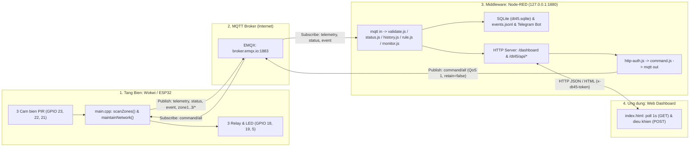

# Đề tài 45: Chiếu sáng kho theo khu vực xe nâng

> **Đồ án môn học Internet of Things (IoT) — Học phần `0101101975`**  
> **Trường Đại học Công Thương TP. Hồ Chí Minh (HUIT) · Khoa Công nghệ Thông tin**  
> **Giảng viên hướng dẫn:** ThS. Võ Hoàng Hải · **Nhóm thực hiện:** Nhóm N08

[](#4-phần-cứng-mô-phỏng--phân-chân-gpio)
[](#8-hướng-dẫn-cài-đặt--chạy-nhanh)
[](#5-giao-thức-mqtt--bộ-topic)
[](#6-tính-năng-chính--logic-điều-khiển)
[](#6-tính-năng-chính--logic-điều-khiển)

---

## Mục lục

1. [Tổng quan đề tài](#1-tổng-quan-đề-tài)
2. [Kiến trúc IoT 4 tầng & Luồng dữ liệu](#2-kiến-trúc-iot-4-tầng--luồng-dữ-liệu)
3. [Công nghệ sử dụng](#3-công-nghệ-sử-dụng)
4. [Phần cứng mô phỏng & Phân chân GPIO](#4-phần-cứng-mô-phỏng--phân-chân-gpio)
5. [Giao thức MQTT & Bộ Topic](#5-giao-thức-mqtt--bộ-topic)
6. [Tính năng chính & Logic điều khiển](#6-tính-năng-chính--logic-điều-khiển)
7. [Cấu trúc thư mục dự án](#7-cấu-trúc-thư-mục-dự-án)
8. [Hướng dẫn cài đặt & Chạy nhanh](#8-hướng-dẫn-cài-đặt--chạy-nhanh)
9. [Kiểm thử & Kết quả đánh giá](#9-kiểm-thử--kết-quả-đánh-giá)
10. [Hạn chế hiện tại & Hướng phát triển](#10-hạn-chế-hiện-tại--hướng-phát-triển)
11. [Thành viên thực hiện & Phân công](#11-thành-viên-thực-hiện--phân-công)

---

## 1. Tổng quan đề tài

Trong nhiều kho logistics truyền thống, toàn bộ hệ thống đèn được bật liên tục suốt ca làm việc hoặc 24/24, trong khi xe nâng thường chỉ bốc xếp cục bộ ở 1–2 lối đi tại một thời điểm. Điều này gây lãng phí lớn điện năng và làm bộ nguồn đèn nhanh xuống cấp.

**Đề tài 45** xây dựng mô hình chiếu sáng thông minh chia kho thành **3 vùng độc lập**:
- **Vùng 1 — Lối kệ A** (kệ pallet)
- **Vùng 2 — Khu phân loại B** (đóng gói, dán nhãn)
- **Vùng 3 — Cửa xuất hàng C** (bốc hàng lên xe tải)

Hệ thống tự động phát hiện chuyển động theo từng vùng để bật đúng đèn cần thiết, giữ sáng trong một khoảng thời gian cấu hình được rồi tự tắt khi kho vắng; đồng thời cho phép người vận hành giám sát thời gian thực, điều khiển từ xa qua **Web Dashboard** hoặc **Telegram Bot**, lưu lịch sử vào **SQLite**, và vẫn đảm bảo **ESP32 tự trị tại chỗ** khi mất kết nối mạng.

---

## 2. Kiến trúc IoT 4 tầng & Luồng dữ liệu

Hệ thống được thiết kế bám sát kiến trúc IoT 4 tầng của học phần:

| Tầng | Thành phần trong đồ án | Vai trò chính |
| :--- | :--- | :--- |
| **Tầng 1 — Cảm biến / Chấp hành** | 3 cảm biến PIR, 3 module relay NPN kích mức cao, 3 LED + điện trở 220 Ω (mô phỏng trên Wokwi) | Thu nhận tín hiệu chuyển động từng vùng và đóng/ngắt tải đèn qua tiếp điểm `COM–NO`. |
| **Tầng 2 — Mạng & Thiết bị biên** | ESP32 DevKit V1 + Wi-Fi 2,4 GHz + MQTT 3.1.1 (`PubSubClient 2.8.0`) | Lọc nhiễu 300 ms, điều khiển đèn không chặn bằng `millis()`, chạy tự trị khi mất mạng, publish telemetry và nhận lệnh QoS 1 có chống lặp ID. |
| **Tầng 3 — Middleware** | EMQX Public Broker (`broker.emqx.io:1883`) + Node-RED (`4.1.7`, 56 node) + SQLite | Định tuyến Pub/Sub, kiểm tra JSON Schema, phân biệt dữ liệu trực tiếp vs `retained`, chạy luật tiết kiệm điện, phát cảnh báo, lưu `events.jsonl` & `dt45.sqlite`, kết nối Telegram Bot. |
| **Tầng 4 — Ứng dụng** | Web Dashboard (`/dashboard`) + REST API (`/dt45/api/*`) | Hiển thị trạng thái 3 vùng, biểu đồ 60 mẫu, thống kê thời gian sáng, truy vấn lịch sử/CSV và điều khiển hai chiều có phân quyền bằng mã phiên. |

### Sơ đồ luồng dữ liệu hai chiều



---

## 3. Công nghệ sử dụng

- **Vi điều khiển & Firmware:** C++ (Arduino Framework trên ESP32), `PlatformIO` (`espressif32@7.1.3`), thư viện `knolleary/PubSubClient@2.8.0`.
- **Mô phỏng phần cứng:** `Wokwi Simulator` for VS Code ([diagram.json](diagram.json), [wokwi.toml](wokwi.toml)).
- **Truyền thông IoT:** MQTT 3.1.1 qua EMQX Broker công cộng (`broker.emqx.io:1883`).
- **Middleware & Backend:** `Node.js` (khuyến nghị `24 LTS`, cần `>= 22.5` cho `node:sqlite`), `Node-RED 4.1.7`, SQLite (`node-red/data/dt45.sqlite`), Telegram Bot API (long-polling `getUpdates`).
- **Frontend:** HTML5, CSS3, Vanilla JavaScript + biểu đồ SVG thuần tại [node-red/dashboard/index.html](node-red/dashboard/index.html).
- **Kiểm thử tự động:** MSVC Build Tools (Host C++ test), Node.js test runner, `MQTTX Desktop` để kiểm tra thủ công.

---

## 4. Phần cứng mô phỏng & Phân chân GPIO

Mạch mô phỏng trong [diagram.json](diagram.json) sử dụng ESP32 DevKit V1, 3 cảm biến PIR, 3 module relay NPN kích mức cao và 3 LED kèm điện trở 220 Ω:

| Phân vùng | Thiết bị ngoại vi | Chân GPIO | Chế độ (`pinMode`) | Logic hoạt động |
| :--- | :--- | :--- | :--- | :--- |
| **Vùng 1 (Lối kệ A)** | PIR 1 (`OUT`) | `GPIO 23` | `INPUT_PULLDOWN` | `HIGH` = có chuyển động; lọc `>= 300 ms` |
| **Vùng 1 (Lối kệ A)** | Relay 1 (`IN`) / LED Đỏ | `GPIO 18` | `OUTPUT` | `HIGH` = đóng tiếp điểm `COM–NO`, bật đèn |
| **Vùng 2 (Phân loại B)** | PIR 2 (`OUT`) | `GPIO 22` | `INPUT_PULLDOWN` | `HIGH` = có chuyển động; lọc `>= 300 ms` |
| **Vùng 2 (Phân loại B)** | Relay 2 (`IN`) / LED Vàng | `GPIO 19` | `OUTPUT` | `HIGH` = đóng tiếp điểm `COM–NO`, bật đèn |
| **Vùng 3 (Cửa xuất C)** | PIR 3 (`OUT`) | `GPIO 21` | `INPUT_PULLDOWN` | `HIGH` = có chuyển động; lọc `>= 300 ms` |
| **Vùng 3 (Cửa xuất C)** | Relay 3 (`IN`) / LED Xanh | `GPIO 5` | `OUTPUT` | `HIGH` = bật đèn *(lưu ý mạch thật nên đổi sang `GPIO 25` vì `GPIO 5` là chân strapping)* |
| **Hệ thống** | UART0 (`TX0`/`RX0`) | Serial | `115200 bps` | Theo dõi log Wi-Fi/MQTT và nhập lệnh trực tiếp |

**Ước tính chi phí phần cứng thực tế (BOM dự kiến trong báo cáo):** khoảng **485.000 VNĐ** cho bộ điều khiển 3 vùng (1 ESP32 DevKit V1, 3 PIR HC-SR501, 3 module relay 5V Songle có opto PC817, 3 cụm LED + điện trở 220 Ω, nguồn 5V/2A, dây nối, vỏ hộp IP65); dòng đỉnh ước tính khoảng `474,5 mA` nên khuyến nghị nguồn rời `5V/2A`.

---

## 5. Giao thức MQTT & Bộ Topic

- **Broker:** `broker.emqx.io` · **Port:** `1883` · **Client ID ESP32:** `dt45-<8 hex MAC>-<8 hex random>` (tránh xung đột khi nhiều phiên Wokwi dùng chung eFuse MAC) · **Keep-alive:** `15 giây`.
- **Tiền tố chung (`MQTT_PREFIX`):** `iot/nhom08/detai45/kho-c7e2` (khai báo tại [include/project_config.h](include/project_config.h)).

| Topic (dưới prefix `iot/nhom08/detai45/kho-c7e2`) | Hướng | QoS | Retain | Nội dung Payload |
| :--- | :--- | :--- | :--- | :--- |
| `/status` | ESP32 / Broker → Node-RED | 0 (LWT: 1) | `true` | `"online"` khi ESP32 kết nối; `"offline"` (LWT) do EMQX tự phát nếu rớt mạng đột ngột |
| `/telemetry` | ESP32 → Node-RED | 0 | `true` | JSON trạng thái tổng hợp 3 vùng, gửi mỗi `2 s` (đồng hồ ESP32) hoặc sau `100 ms` khi trạng thái đổi |
| `/zone1..3/led` | ESP32 → MQTTX | 0 | `true` | `"ON"` hoặc `"OFF"` |
| `/zone1..3/motion` | ESP32 → MQTTX | 0 | `true` | `"MOTION_DETECTED"` hoặc `"CLEAR"` |
| `/zone1..3/mode` | ESP32 → MQTTX | 0 | `true` | `"AUTO"` hoặc `"MANUAL"` |
| `/command/all` | Node-RED / MQTTX → ESP32 | 1 | `false` | Dạng có ID: <code>CMD&#124;&lt;id&gt;&#124;&lt;LỆNH&gt;</code> (ví dụ <code>CMD&#124;c-mvapjamd-3&#124;ON1</code>) hoặc lệnh ngắn gửi tay như `ON1` |
| `/event` | ESP32 → Node-RED | 0 | `false` | JSON ACK xác nhận kết quả thực thi lệnh kèm `id`, `command`, `result`, `reason`, `uptime_ms` |

<details>
<summary>Xem ví dụ JSON Telemetry và Event ACK thực tế</summary>

**Payload `/telemetry`:**
```json
{
  "device": "dt45-00c40a24-c90499b0",
  "uptime_ms": 58432,
  "timeout_ms": 10000,
  "prelight_enabled": false,
  "prelight_hold_ms": 5000,
  "session_ms": 57242,
  "zones": [
    {"id": 1, "pir": 1, "motion": true, "led": true, "mode": "AUTO", "on_ms": 19085},
    {"id": 2, "pir": 0, "motion": false, "led": false, "mode": "AUTO", "on_ms": 0},
    {"id": 3, "pir": 0, "motion": false, "led": false, "mode": "AUTO", "on_ms": 0}
  ]
}
```

**Payload `/event` (ACK):**
```json
{
  "type": "command",
  "result": "OK",
  "id": "c-mvapjamd-3",
  "command": "OFF1",
  "reason": "",
  "uptime_ms": 53116
}
```

</details>

---

## 6. Tính năng chính & Logic điều khiển

### Tại Firmware ESP32 ([src/main.cpp](src/main.cpp))
- **Non-blocking & ổn định bộ nhớ:** không dùng `delay()` (quét PIR mỗi `20 ms`), không cấp phát `String` động (dùng bộ đệm tĩnh + `snprintf()`/`vsnprintf()`), dùng phép trừ `uint32_t` an toàn khi `millis()` quay vòng sau ~49,7 ngày.
- **Lọc nhiễu & giữ đèn tự động:** chỉ công nhận chuyển động khi PIR giữ `HIGH` liên tục `>= 300 ms` (`DEBOUNCE_MS`); giữ đèn mặc định `10 s` sau chuyển động hợp lệ cuối cùng, chỉnh được `3–300 s` từ xa qua lệnh `TIMEOUT=X` không cần nạp lại firmware.
- **Pre-light vùng liền kề:** khi bật `PRELIGHT_ON`, vùng có chuyển động hợp lệ sẽ bật đón đầu các vùng liền kề thêm `5 s` (`NEIGHBOR_HOLD_MS`); vùng sáng do pre-light không kích lan dây chuyền và luôn nhường ưu tiên cho lệnh thủ công.
- **Thứ tự ưu tiên điều khiển:** `Thủ công (MANUAL)` > `Quy tắc kho vắng (Node-RED gửi AUTO)` > `Tự động theo PIR (AUTO)`.
- **Chống lặp lệnh QoS 1:** lưu 8 biên nhận ID gần nhất (`receipts[8]`); nếu broker giao lại cùng ID và lệnh thì trả ACK `duplicate` mà không thực thi lại, nếu trùng ID nhưng khác lệnh thì từ chối (`id_conflict`).
- **Fail-safe khi mất mạng:** mất Wi-Fi (`WIFI_RETRY_MS = 10 s`) hay mất MQTT (`MQTT_RETRY_MS = 5 s`), ESP32 vẫn tự bật/tắt đèn theo PIR và nhận lệnh qua Serial; khi có mạng lại tự `subscribe` và gửi lại snapshot đầy đủ.
- **Thống kê thời gian sáng:** đo `session_ms` và `on_ms` từng vùng bằng bộ đếm 64-bit (`uint64_t`).

### Tại Node-RED Middleware ([node-red/flows.json](node-red/flows.json) — 56 node)
- **Kiểm tra dữ liệu (`validate.js`):** kiểm tra schema JSON 3 vùng, tách bản tin trực tiếp (`retain !== true`) với bản tin cũ lưu trên broker (`retained`), phát hiện ESP32 khởi động lại (`uptime_ms` giảm) để reset bộ đếm cảnh báo.
- **Quy tắc tiết kiệm điện (`rule.js`):** mặc định **TẮT**; khi bật, nếu có ít nhất 1 đèn đang `MANUAL ON` và cả 3 vùng không có chuyển động liên tục đủ ngưỡng (`15–300 s`, mặc định `30 s`) thì tự gửi `AUTO` đưa cả 3 vùng về tự động.
- **Giám sát sự cố & Cảnh báo (`monitor.js`):**
  - `DEVICE_OFFLINE`: mất telemetry trực tiếp quá `15 s` (`DT45_LIVE_WINDOW_MS`, điều chỉnh phù hợp với tốc độ mô phỏng chậm của Wokwi) hoặc nhận LWT `"offline"` từ EMQX → khóa nút điều khiển.
  - `COMMAND_TIMEOUT`: quá `12 s` chưa nhận ACK cho lệnh đã gửi → không tuyên bố thành công giả.
  - `PIR_HIGH_LONG`: PIR giữ `HIGH` liên tục quá ngưỡng (mặc định `120 s`, chỉnh `5–3600 s`) → cảnh báo kiểm tra cảm biến, không tự tắt đèn.
  - `MANUAL_LIGHT_IDLE`: đèn thủ công sáng khi kho vắng quá `60 s` (chỉnh `15–300 s`).
  - `AFTER_HOURS_MOTION`: có chuyển động ngoài khung giờ ca làm việc tính theo giờ Việt Nam (`UTC+7`, hỗ trợ ca qua đêm như `22:00–06:00`).
- **Lưu trữ bền vững (`dt45-store.cjs` & `history.js`):** ghi log JSONL ra `node-red/logs/events.jsonl` và lưu vào **CSDL SQLite** (`node-red/data/dt45.sqlite`) gồm 2 bảng `telemetry_log` (lưu khi đổi hoặc mỗi `10 s`) và `event_log` (lưu tức thì).
- **Telegram Bot (`dt45-telegram.cjs`, tùy chọn):** gửi cảnh báo tức thời và nhận lệnh `/status`, `/on1`…`/off3`, `/allon`, `/alloff`, `/auto`, chỉ cho phép các `DT45_TELEGRAM_CHAT_ID` được cấu hình.

### Tại Web Dashboard ([node-red/dashboard/index.html](node-red/dashboard/index.html))
- Phục vụ tại `http://127.0.0.1:1880/dashboard`, polling `GET /dt45/api/state` mỗi giây.
- Phân quyền rõ ràng: mặc định **Chỉ xem**; nhập mã phiên (`DT45_CONTROL_TOKEN` in ở terminal Node-RED, gửi qua header `x-dt45-token`) để mở quyền **Điều khiển**.
- Hiển thị trực quan 3 lối kho, trạng thái ACK/RTT lệnh gần nhất, biểu đồ SVG 60 mẫu, ước tính % tiết kiệm thời gian sáng, form cấu hình đèn/quy tắc/cảnh báo, bảng nhật ký trực tiếp và trình truy vấn lịch sử SQLite / xuất CSV (`/dt45/api/history`).

---

## 7. Cấu trúc thư mục dự án

```text
DeTai45_ChieuSangKho_Demo_Nhom08/
├── include/
│   └── project_config.h          # Cấu hình Wi-Fi, EMQX broker, MQTT prefix, chu kỳ retry/telemetry
├── src/
│   └── main.cpp                  # Firmware ESP32: quét PIR, lọc 300ms, giữ đèn, Serial & MQTT hai chiều
├── node-red/
│   ├── build-flow.cjs            # Script sinh node-red/flows.json từ các file nguồn JS & HTML
│   ├── flows.json                # Flow Node-RED hoàn chỉnh (56 node)
│   ├── settings.js               # Cấu hình Node-RED (127.0.0.1:1880), SQLite & Telegram global context
│   ├── start.ps1                 # Script tự cài runtime Node-RED 4.1.7 (nếu thiếu), sinh token & khởi chạy
│   ├── telegram.local.example.ps1# Mẫu cấu hình Telegram token & Chat ID (file .local nằm trong .gitignore)
│   ├── dashboard/
│   │   └── index.html            # Giao diện Web Dashboard
│   ├── functions/                # Mã nguồn rời của 14 Function node (validate, rule, command, monitor, ...)
│   ├── lib/
│   │   ├── dt45-store.cjs        # Lớp lưu trữ SQLite (node:sqlite)
│   │   └── dt45-telegram.cjs     # Tích hợp Telegram Bot API (long-polling)
│   ├── data/                     # CSDL SQLite (dt45.sqlite)
│   └── logs/                     # Nhật ký sự kiện (events.jsonl)
├── test/
│   ├── host/                     # 51 unit test C++ chạy trên máy tính với phần cứng/MQTT giả lập
│   ├── node_red_test.cjs         # 33 unit test cho các Function node Node-RED
│   ├── dashboard_test.cjs        # 6 nhóm test script dashboard
│   ├── log_summary_test.cjs      # 5 test công cụ thống kê log
│   ├── storage_telegram_test.cjs # 12 test SQLite & Telegram bot (mock API)
│   ├── e2e_week68_test.cjs       # 17 test E2E qua Node-RED + EMQX thật với thiết bị giả lập
│   ├── mqtt_integration_test.cjs # Test tích hợp MQTT cơ bản (tuần 4–5)
│   ├── run_host_tests.ps1        # Script biên dịch và chạy host test C++ (MSVC)
│   └── README.md                 # Tài liệu chi tiết bộ kiểm thử
├── tools/
│   ├── verify.ps1                # Script chạy kiểm thử hồi quy toàn hệ thống
│   └── log_summary.cjs           # Công cụ thống kê RTT ACK và sự kiện từ events.jsonl
├── diagram.json                  # Sơ đồ mạch Wokwi (ESP32 + 3 PIR + 3 Relay + 3 LED)
├── diagram-relay.json            # Phương án sơ đồ relay tham khảo
├── platformio.ini                # Cấu hình PlatformIO (ESP32 DevKit V1 + PubSubClient 2.8.0)
├── wokwi.toml                    # Trỏ Wokwi tới firmware.bin / firmware.elf sau khi build
├── HUONG_DAN_CHAY_NHOM08.md      # Tài liệu hướng dẫn cài đặt, demo và kiểm thử chi tiết từng bước
└── README.md                     # Tài liệu tổng quan dự án
```

---

## 8. Hướng dẫn cài đặt & Chạy nhanh

Xem hướng dẫn từng bước đầy đủ tại [HUONG_DAN_CHAY_NHOM08.md](HUONG_DAN_CHAY_NHOM08.md). Tóm tắt quy trình chạy trên **Windows**:

### Yêu cầu phần mềm
1. **VS Code** kèm extension **PlatformIO IDE** và **Wokwi Simulator** (đã kích hoạt license Wokwi via `F1 → Wokwi: Request a new License`).
2. **Node.js 24 LTS** (tối thiểu `22.5+` để dùng `node:sqlite`).
3. **MQTTX Desktop** (tùy chọn, dùng để soi bản tin MQTT trực tiếp).
4. Kết nối **Internet** (Wokwi và Node-RED kết nối tới `broker.emqx.io:1883`).

### Các bước khởi chạy
1. **Build firmware ESP32** (bắt buộc trước khi chạy Wokwi để tạo `.pio\build\esp32doit-devkit-v1\firmware.bin` và `firmware.elf`):
   - Trong VS Code nhấn `F1` → **`PlatformIO: Build`**, hoặc chạy trong PowerShell tại thư mục gốc dự án:
     ```powershell
     & "$env:USERPROFILE\.platformio\penv\Scripts\pio.exe" run
     ```
2. **Chạy mô phỏng Wokwi:**
   - Mở `diagram.json` và bấm nút **Play** (hoặc `F1` → **`Wokwi: Start Simulator`**).
   - Kiểm tra Serial Monitor thấy `[WiFi] Connected.`, `[MQTT] Connected; SUB iot/nhom08/detai45/kho-c7e2/command/all` và `[MQTT] TX telemetry OK`.
3. **Khởi động Node-RED & Dashboard:**
   - Mở một terminal PowerShell mới tại thư mục gốc dự án và chạy:
     ```powershell
     powershell -ExecutionPolicy Bypass -File .\node-red\start.ps1
     ```
   - Sao chép chuỗi sau dòng `Ma dieu khien dashboard:` được in trên terminal.
4. **Mở trình duyệt:**
   - Truy cập Dashboard: **`http://127.0.0.1:1880/dashboard`** → bấm **Mở điều khiển** và dán mã phiên.
   - Truy cập Node-RED Editor (xem flow & debug): **`http://127.0.0.1:1880`**.
5. *(Tùy chọn)* **Bật Telegram Bot:** sao chép `node-red/telegram.local.example.ps1` thành `node-red/telegram.local.ps1`, điền `DT45_TELEGRAM_TOKEN` (từ `@BotFather`) và `DT45_TELEGRAM_CHAT_ID`, sau đó khởi động lại `start.ps1`.
6. *(Lưu ý khi sửa code Node-RED)* Nếu chỉnh sửa file trong `node-red/functions/` hoặc `node-red/dashboard/index.html`, chạy lại lệnh sau rồi khởi động lại Node-RED:
   ```powershell
   node .\node-red\build-flow.cjs
   ```

### Bảng lệnh điều khiển nhanh

| Lệnh (Serial / MQTT) | Lệnh Telegram | Tác dụng |
| :--- | :--- | :--- |
| `ON1`, `ON2`, `ON3` / `OFF1`, `OFF2`, `OFF3` | `/on1`..`/on3`, `/off1`..`/off3` | Bật/tắt thủ công từng vùng (chuyển sang `MANUAL`) |
| `ALL_ON` / `ALL_OFF` | `/allon` / `/alloff` | Bật/tắt toàn bộ 3 vùng (`MANUAL`) |
| `AUTO` | `/auto` | Đưa cả 3 vùng về chế độ tự động theo PIR |
| `TIMEOUT=15` | — | Đổi thời gian giữ đèn `3–300` giây (mặc định `10 s`) |
| `PRELIGHT_ON` / `PRELIGHT_OFF` | — | Bật/tắt chiếu sáng đón đầu vùng liền kề (`5 s`) |
| `STATUS` / `HELP` | `/status` / `/help` | Xem trạng thái 3 vùng hoặc danh sách lệnh |

---

## 9. Kiểm thử & Kết quả đánh giá

### Chạy bộ kiểm thử tự động
Chi tiết từng suite xem tại [test/README.md](test/README.md). Để chạy toàn bộ kiểm thử hồi quy:

```powershell
# Chạy đầy đủ (build + host C++ + Node-RED + dashboard + log + SQLite/Telegram + E2E EMQX)
powershell -ExecutionPolicy Bypass -File .\tools\verify.ps1

# Bỏ qua bước build hoặc bước cần mạng nếu kiểm thử offline
powershell -ExecutionPolicy Bypass -File .\tools\verify.ps1 -SkipBuild -SkipNetwork

# Thống kê RTT ACK và sự kiện từ nhật ký thực tế
node .\tools\log_summary.cjs .\node-red\logs\events.jsonl
```

### Tổng hợp bộ kiểm thử trong mã nguồn
- **Host C++ (`test/host/firmware_test.cpp`):** `51` ca kiểm thử logic lọc 300 ms, timeout giữ đèn, tràn số `millis()`, pre-light, MQTT offline/reconnect và chống lặp 8 ID.
- **Node-RED Functions (`test/node_red_test.cjs`):** `33` ca kiểm tra schema validation, rule kho vắng, cảnh báo bất thường và phân quyền.
- **Dashboard Script (`test/dashboard_test.cjs`):** `6` nhóm kiểm tra giao diện & trạng thái nút trên DOM giả lập.
- **Thống kê Log (`test/log_summary_test.cjs`):** `5` ca kiểm tra ghép lệnh–ACK và tính quantile độ trễ.
- **SQLite & Telegram (`test/storage_telegram_test.cjs`):** `12` ca kiểm tra lưu trữ SQLite, truy vấn lịch sử/CSV và phân quyền Telegram (mock API).
- **E2E MQTT/API (`test/e2e_week68_test.cjs`):** `17` kiểm tra tích hợp qua Node-RED + EMQX thật với thiết bị giả lập và Telegram mock API.

### Kết quả đo trên mô phỏng & Ước tính năng lượng (từ báo cáo)
- **Tài nguyên firmware ESP32 (PlatformIO build 16/11/2026):** RAM `13,9%` (`45.568 / 327.680 bytes`), Flash `57,6%` (`755.005 / 1.310.720 bytes`).
- **Độ trễ phản hồi lệnh (Node-RED → EMQX → Wokwi → ACK):** qua `31` lệnh đo trong `events.jsonl` có trung vị **`1.297 ms` (~`1,30 s`)**, P95 **`9.726 ms`** (dao động do tốc độ giả lập Wokwi đạt khoảng `15–80%` thời gian thực).
- **Ước tính hiệu quả năng lượng (mô hình giả định):** trên kho giả định `1.000 m²` tổng công suất đèn `4.500 W` + hạ tầng IoT `7,5 W`, mức tiêu thụ giảm từ `108,00 kWh/ngày` (bật 24/24) xuống **`42,08 kWh/ngày`** (**giảm ~`61,04%`**; hoặc giảm ~`41,56%` so với bật `16 giờ/ngày`). *Lưu ý: đây là con số tính từ mô hình thời gian bật giả định, chưa đo công suất điện thực tế.*

---

## 10. Hạn chế hiện tại & Hướng phát triển

**Hạn chế đã nhận diện:**
- Wokwi chạy chậm hơn thời gian thực nên dễ kích hoạt timeout nếu đặt ngưỡng quá ngắn (đã khắc phục bằng ngưỡng `15 s`, tùy biến qua `DT45_LIVE_WINDOW_MS`).
- Cảm biến PIR chỉ phát hiện vật thể mang nhiệt đang di chuyển, chưa phân biệt được xe nâng với người và có thể tắt đèn nếu xe dừng yên lâu hơn `timeout_ms`.
- Hệ thống mới xác thực trên mô phỏng Wokwi và kiểm thử tự động, chưa triển khai trên mạch thật; broker công cộng `broker.emqx.io:1883` chưa có mã hóa TLS và phân quyền ACL riêng.

**Hướng phát triển tiếp theo:**
- Kết hợp thêm **radar mmWave 24 GHz** (phát hiện người/xe đứng yên) và **thẻ UWB/RFID** hoặc camera AI để định danh xe nâng chính xác.
- Thay relay cơ bằng **SSR** hoặc bộ điều chỉnh độ sáng (dimming 0–10V / PWM) kết hợp cảm biến ánh sáng **BH1750** để tận dụng ánh sáng tự nhiên.
- Tích hợp module đo điện năng **PZEM-004T** để đo kWh thực tế thay cho ước tính theo thời gian sáng.
- Chuyển sang **MQTTS (TLS port 8883)** có tài khoản/ACL riêng và mở rộng nhiều cụm đèn bằng ESP-NOW / ESP-MESH.

---

## 11. Thành viên thực hiện & Phân công

| MSSV | Họ và tên | Vai trò & Phụ trách chính | Tỷ lệ đóng góp |
| :--- | :--- | :--- | :--- |
| `2001231038` | **Nguyễn Quốc Việt** *(Nhóm trưởng)* | Thiết kế mạch Wokwi, lập trình firmware ESP32, lọc PIR/timeout/pre-light, host test & demo E2E | `33,33%` |
| `2001230978` | **Trần Trọng Trí** | Thiết kế topic MQTT, flow Node-RED, giám sát kết nối, API phân quyền, tổng hợp báo cáo & slide | `33,33%` |
| `2001230745` | **Nguyễn Thị Quyên** | Quy tắc tự động & cảnh báo, giao diện Web Dashboard, thống kê điện năng/độ trễ & video demo | `33,33%` |
